<div align="center">



# Puco

**A little desk robot that keeps an eye on your computer.**

CPU, memory, temperature and battery on a white vinyl robot with LED gauges,
plus a notch island that only speaks up when something needs you.

macOS · Windows · Linux &nbsp;—&nbsp; built with Tauri 2, Svelte 5 and Three.js

</div>

---

## Contents

- [Features](#features)
- [Install](#install)
- [Build from source](#build-from-source)
- [Using Puco](#using-puco)
- [Alerts](#alerts)
- [Platform support](#platform-support)
- [Privacy](#privacy)
- [How it works](#how-it-works)
- [Contributing](#contributing)
- [License](#license)

## Features

- **A robot with moods.** A 3D white vinyl robot whose screen-face reacts to your machine:
  calm when idle, strained under load, sleepy at night. Around 20 reactions to clicks, petting,
  rapid pokes and sudden CPU spikes.
- **Glanceable gauges.** CPU, memory and a one-minute temperature trace, drawn as LED dot-matrix
  screens behind black glass.
- **Process list.** The top processes by CPU or memory, with "show in file manager" and a
  two-step quit.
- **Notch island (macOS).** Sits exactly on the camera notch and stays invisible until it has
  something to say. It works over full-screen apps too.
- **Quiet by default.** Alerts fire once per problem with hysteresis, never in a loop.
- **Small.** A ~4.5 MB app bundle and a 30 fps frame cap. No network access.

## Install

Pre-built installers aren't published yet. [Build from source](#build-from-source); it's three commands.

> Builds are unsigned, so on first launch macOS Gatekeeper and Windows SmartScreen will warn you.
> On macOS, right-click `Puco.app` → **Open** once.

## Build from source

### Prerequisites

| OS | Install |
|---|---|
| All | Node 20+, Rust stable via [`rustup`](https://rustup.rs) |
| macOS | `xcode-select --install` |
| Windows | MSVC Build Tools ("Desktop development with C++") and WebView2 (preinstalled on Windows 11) |
| Debian / Ubuntu | `sudo apt install libwebkit2gtk-4.1-dev build-essential curl wget file libxdo-dev libssl-dev libayatana-appindicator3-dev librsvg2-dev` |
| Fedora | `sudo dnf install webkit2gtk4.1-devel openssl-devel libappindicator-gtk3-devel librsvg2-devel` plus the `"Development Tools"` group |

### Develop

```bash
npm install
npm run tauri dev      # hot-reloads the UI and rebuilds Rust on change
```

### Package

```bash
npm run tauri build
```

The installers land in `src-tauri/target/release/bundle/`:

| Built on | Output |
|---|---|
| macOS | `macos/Puco.app`, `dmg/Puco_<version>_<arch>.dmg` |
| Windows | `nsis/Puco_<version>_x64-setup.exe`, `msi/*.msi` |
| Linux | `appimage/*.AppImage`, `deb/*.deb`, `rpm/*.rpm` |

Each OS builds only its own installers, so use a CI matrix (for example
[`tauri-apps/tauri-action`](https://github.com/tauri-apps/tauri-action)) to build all three.

For a universal macOS binary:

```bash
rustup target add x86_64-apple-darwin aarch64-apple-darwin
npm run tauri build -- --target universal-apple-darwin
```

## Using Puco

### The widget

The keys on the top rail:

| Key | Does |
|---|---|
| Lock | Pins the widget in place (no dragging) |
| Menu bar | Switches between a popup that opens from the menu bar and hides on blur, and a window floating on the desktop |
| Click-through | Lets clicks pass through the widget. Turn it off from the tray menu; it isn't kept between launches |
| Hide | Hides the widget; bring it back from the tray |

Tray menu → **Move to primary screen** rescues a widget left on an unplugged monitor.

### The robot

| Do | It does |
|---|---|
| Click | A random reaction: giggle, heart eyes, shy, stat card, wave, spin… |
| Click rapidly | Gets dizzy, then grumpy |
| Double-click | Backflip |
| Stroke it with the cursor | Enjoys it (floating hearts) |
| Rest the cursor on it | Gets curious |
| Leave it alone | Yawns, hums, stretches, dozes off; sleepier at night |

### The notch island (macOS)

| State | When | Shows |
|---|---|---|
| Rest | Nothing to report | Nothing; it matches the notch exactly |
| Glance (~2.5 s) | Charging, unplugged, fully charged, problem cleared | Face beside the camera, value on the other side |
| Heads-up | High CPU, memory nearly full, battery low | Opens for 6 s with the cause, then stays as a live indicator until the problem clears |

Hover the indicator to open it again, then **Quit &lt;top process&gt;** (click twice) or **Dismiss**.
The island only takes clicks while the cursor is over the visible pill.
Tray → **Test the notch island** plays a sample. On displays without a notch it becomes a floating pill.

## Alerts

Each alert sends a native notification and an island heads-up. Alerts are edge-triggered: they fire
once, then re-arm only after the value recovers.

| Alert | Fires | Re-arms |
|---|---|---|
| CPU load | > 85% for 15 s | < 70% |
| Memory | > 90% | < 85% |
| Battery low | < 20% while discharging | On charging or recovery |
| Fully charged | 100% | After dropping below 95% |

The mood thresholds live in `T` at the top of [`src/lib/engine.ts`](src/lib/engine.ts); the alert
thresholds are in [`src-tauri/src/telemetry.rs`](src-tauri/src/telemetry.rs).

## Platform support

| | macOS | Windows | Linux |
|---|:-:|:-:|:-:|
| Widget, robot, process list | ✓ | ✓ | ✓ |
| Temperature | ✓ | Usually none¹ | ✓ |
| Battery | ✓ | ✓ | ✓ |
| Notifications | ✓ | ✓ | ✓ |
| Notch island | ✓ | — | — |
| Tray click to toggle | ✓ | ✓ | Menu only² |

1. Windows rarely exposes sensors without admin/WMI. The strip then shows CPU load and says so.
2. AppIndicator sends no click events, so use **Show / Hide** in the tray menu. GNOME needs the AppIndicator extension.

On **Wayland**, the compositor controls always-on-top and window position and may ignore them. Run
with `GDK_BACKEND=x11` for full behaviour.

## Privacy

Puco reads system stats locally once a second and never sends anything anywhere: no network
requests, no analytics, no accounts. Quitting a process uses the normal OS signal. Puco never
elevates privileges, and it refuses to quit itself.

## How it works

```
┌────────────── Rust (src-tauri) ──────────────┐        ┌────────────── WebView ──────────────┐
│ telemetry.rs  1 Hz sysinfo + battery poll    │ event  │ App.svelte   widget: gauges, list    │
│               top processes, alert hysteresis├───────►│ bot3d.ts     Three.js robot + acts   │
│ main.rs       windows, tray, prefs, notch,   │        │ led.ts       LED matrix + pixel font │
│               island panel, kill / reveal    │◄───────┤ island.ts    notch island director   │
└──────────────────────────────────────────────┘ invoke └──────────────────────────────────────┘
```

| Path | Role |
|---|---|
| `src-tauri/src/telemetry.rs` | Polling thread, top processes, debounced alerts (unit-tested) |
| `src-tauri/src/main.rs` | Windows, tray menu, prefs, notch measurement, non-activating island panel |
| `src/lib/bot3d.ts` | The 3D robot, its LED face screen and its reaction system |
| `src/lib/led.ts` | Dot-matrix renderer with bloom, 3×5 pixel font |
| `src/lib/engine.ts` | Palettes, thresholds, gauges (flask, hex lattice, sparkline), quips |
| `src/App.svelte` | Widget layout, 30 fps frame loop, process list |
| `island.html`, `src/island.ts` | Notch island: geometry, glances, heads-ups, actions |

To float over full-screen apps on macOS, the island window is converted to a non-activating
`NSPanel` *before it's first shown*. A regular window can't join another app's full-screen Space.

## Contributing

Issues and pull requests are welcome.

```bash
cd src-tauri && cargo test     # alert logic
npm run build                  # bundle the UI
```

- Keep it light: measure CPU and memory before and after anything that touches the frame loop.
- New reactions go in the act table in `src/lib/bot3d.ts`.
- To change the icon, edit `app-icon.svg`, then run `npm run icons`.

## License

[MIT](LICENSE)
